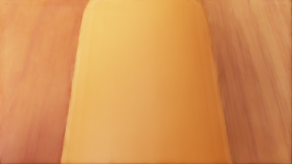
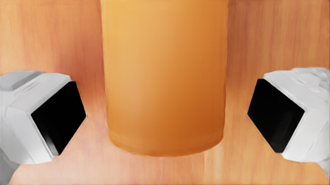

# Lift Can: wrist-camera configuration

This note applies to `lift_can` in UniVTAC's `NeoSim` branch and reproduction checks with
[`NeoteAI/n0_VTLA_univtac_single8`](https://huggingface.co/NeoteAI/n0_VTLA_univtac_single8).
Camera configuration materially affected performance in our reproduction checks. Record it
alongside the simulator revision when comparing results.

## The version-dependent behavior

| Simulator code | Setting in the simulator process | Wrist-camera behavior |
|---|---|---|
| Unmodified `695a22d` | Any value, including `0` | Additional −30° tilt; focal length `1.3` |
| Code containing the camera-switch fix | `UNIVTAC_LIFT_CAN_FIXEDCAM=0`, or unset | Original mount orientation; focal length `1.94` in the standard scene |
| Code containing the camera-switch fix | `UNIVTAC_LIFT_CAN_FIXEDCAM=1` | Additional −30° tilt; focal length `1.3` |

The adjustment was introduced by
[`b375934`](https://github.com/anlorla/UniVTAC/commit/b3759340b4c1e2d010183074e5c7562997e15c26).
[`eedc61d`](https://github.com/anlorla/UniVTAC/commit/eedc61dc078e496082b69667c118710f842fbc73)
makes it opt-in. **An environment variable cannot disable the adjustment in the older code
that does not read that variable.** The original view means no *additional* tilt, not an
identity camera rotation.

## Select and verify the original-camera setup

1. Use a NeoSim revision containing `eedc61d`, or apply its change to `envs/lift_can.py` if
   retaining an older simulator checkout. Keep a record of the base revision and the patch;
   changing the entire simulator version may affect other tasks.
2. Set the following **before launching the simulator/evaluation process**, including inside
   its container or remote job. Setting it only for the model server does not change the
   simulated camera.

   ```bash
   export UNIVTAC_LIFT_CAN_FIXEDCAM=0
   ```

3. After scene creation and task initialization, verify the actual wrist-camera USD prim
   (normally `/World/envs/env_0/Robot/WristCamera/Camera`): focal length should be approximately
   `1.94`, with the original mount transform. Save the initial wrist image as well; checking
   the environment variable alone does not verify the rendered view.

For a policy trained with the tilted view, explicitly select `1` instead. Training and
evaluation must use matching camera geometry; neither setting is a universal default for
every checkpoint.

## Example initial views

These are initial wrist images from our camera comparison on the same environment seed
(`100`). Simulator initialization can still vary slightly between runs.

| Original camera: no additional tilt, focal `1.94` | Tilted camera: −30°, focal `1.3` |
|---|---|
|  |  |

## Reporting reproduction results

Record the checkpoint revision, simulator revision and patches, actual camera mode, tactile
field and baseline handling, prompt, environment seeds, inference RNG handling, action-chunk
execution length, episode limit, and retry policy.

For the Lift Can checks discussed here, the prompt was `lift can`, the tactile field was
`rgb_marker`, the environment seeds were `100–119`, each predicted 50-action chunk was executed
in full unless the episode ended, and the action limit was `600`.

Report first-attempt results separately from retries. Re-running only failed episodes does
not produce a new full-set first-attempt success rate. The historical model-card percentages
are reference results, not a guarantee that every run will reach the same score after a
camera change.

We found no change to Lift Can's `check_success`, `check_early_stop`, or `check_mid_success`
between the inspected revisions `695a22d` and `6ce36e9`. This note documents a camera
configuration difference, not a change to those scoring methods.
